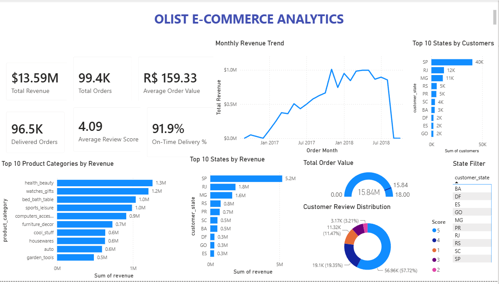
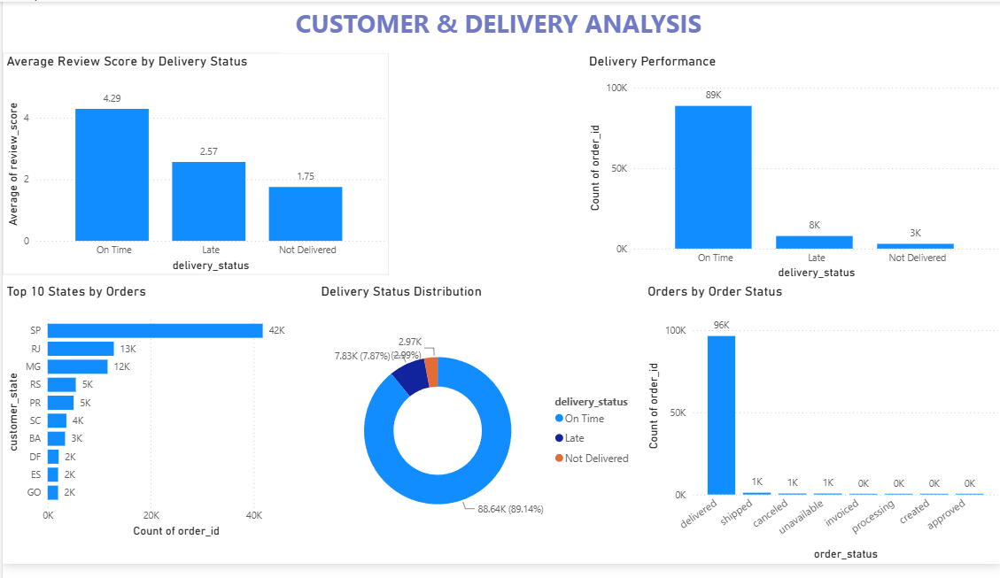

# Olist E-Commerce Sales & Customer Analytics Dashboard

## 📊 Project Overview

This project is an interactive **Power BI E-Commerce Analytics Dashboard** built using the Olist e-commerce dataset.

The dashboard provides a comprehensive view of sales performance, customer behavior, product categories, geographical performance, order status, customer reviews, and delivery performance.

The main objective of this project is to transform raw e-commerce data into meaningful business insights using **Power BI, Power Query, DAX, and data visualization**.

---

## 🎯 Business Objectives

- Analyze overall e-commerce sales performance
- Track revenue and order trends over time
- Identify top-performing product categories
- Identify high-performing states
- Analyze customer review ratings
- Evaluate delivery performance
- Analyze order status distribution
- Understand customer and order patterns

---

## 🛠️ Tools & Technologies

- **Power BI Desktop**
- **Power Query**
- **DAX**
- **Data Cleaning & Transformation**
- **Data Visualization**
- **Excel / CSV Dataset**

---

## 📌 Dashboard Pages

### 1. Executive Overview

The Executive Overview provides a high-level summary of business performance.

### Key KPIs

- Total Revenue: **$13.59M**
- Total Orders: **99.4K**
- Average Order Value: **R$159.33**
- Delivered Orders: **96.5K**
- Average Review Score: **4.09 / 5**
- On-Time Delivery: **91.9%**

### Visualizations

- Monthly Revenue Trend
- Top 10 States by Customers
- Top 10 Product Categories by Revenue
- Top 10 States by Revenue
- Total Order Value
- Customer Review Distribution
- State Filter

---

### 2. Customer & Delivery Analysis

This page focuses on customer satisfaction and delivery performance.

### Visualizations

- Average Review Score by Delivery Status
- Delivery Performance
- Top 10 States by Orders
- Delivery Status Distribution
- Orders by Order Status

---

## 🔍 Key Business Insights

### 💰 Sales Performance

The business generated approximately **$13.59M in total revenue** from around **99.4K orders**.

### 🛍️ Top Product Category

**Health & Beauty** is the highest-revenue product category with approximately **$1.26M** in revenue.

### 📍 Top Performing State

**São Paulo (SP)** is the strongest-performing state, generating approximately **$5.2M** in revenue and having around **40K customers**.

### 🚚 Delivery Performance

Approximately **91.9% of orders were delivered on time**, indicating strong overall delivery performance.

### ⭐ Customer Satisfaction

The overall average review score is approximately **4.09/5**, showing generally positive customer satisfaction.

### 📦 Delivery Status

Approximately **88.6K orders were delivered on time**, while around **7.8K were late** and **3K were not delivered** based on the delivery-status analysis.

---

## 📈 Dashboard Features

- Interactive KPI cards
- Dynamic filters
- Drill-through support
- Interactive charts
- Revenue analysis
- Customer analysis
- Delivery analysis
- Product category analysis
- Geographical analysis
- Order status analysis

---

## 🧹 Data Preparation

The dataset was prepared before visualization using Power Query and calculated measures.

Main data preparation activities included:

- Handling missing values
- Data type conversion
- Cleaning categorical fields
- Creating calculated columns
- Creating DAX measures
- Creating revenue and order metrics
- Creating delivery-status classifications
- Creating monthly revenue analysis
- Creating Top 10 category and state analysis

---

## 📸 Dashboard Preview

### Executive Overview

### Customer & Delivery Analysis

